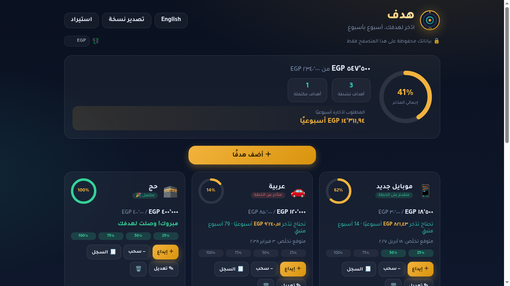
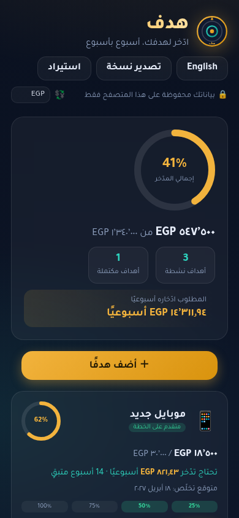
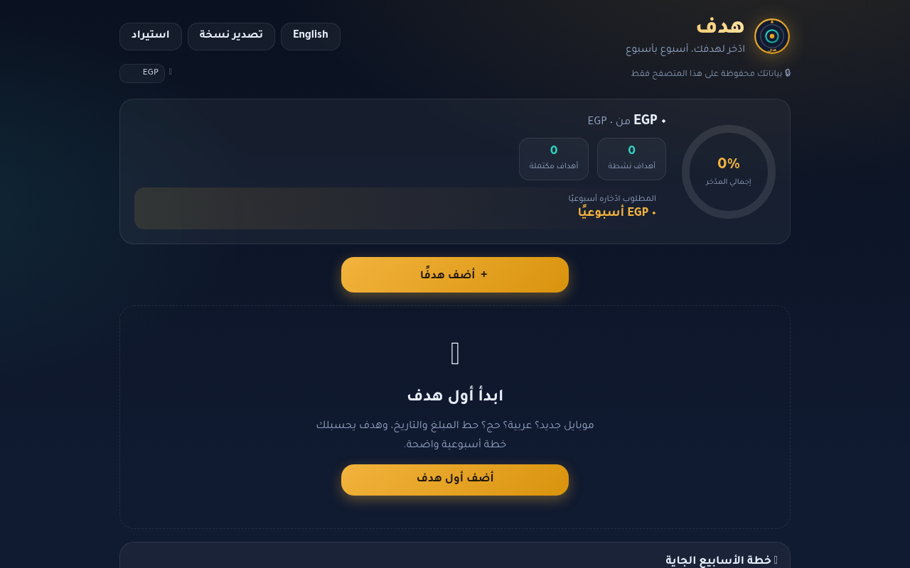
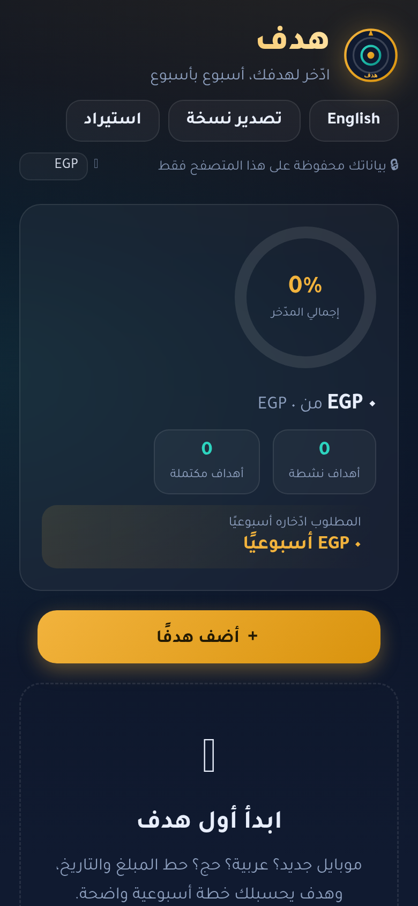

<p align="center">
  
</p>

<h1 align="center">Hedaf · هدف</h1>

<p align="center">
  <strong>Save toward your goal, week by week.</strong><br>
  A bilingual (Arabic/English, RTL) savings-goals visualizer: phone, car, Hajj, anything —
  set the target and date, and Hedaf turns it into a clear weekly plan you can actually follow.
</p>

<p align="center">
  <a href="https://yousefkhames.github.io/hedaf/"><strong>▶ Live demo</strong></a> ·
  <a href="#features">Features</a> ·
  <a href="#tech">Tech</a> ·
  <a href="#honest-limits">Honest limits</a> ·
  <a href="LICENSE">MIT License</a>
</p>

<p align="center">
  
</p>

<p align="center">
  
</p>

## Screenshots

Captured from the live site (https://yousefkhames.github.io/hedaf/).

<p>
  
  
</p>

## Why

Big goals feel vague. "I want a car someday" never moves anyone — "8,250 EGP every week
for 79 weeks" does. Hedaf converts a dream into a weekly number, tracks every deposit,
and shows whether you're ahead of the plan or slipping, in Arabic or English.

## Features

- **Savings goals with presets** — phone 📱, car 🚗, Hajj 🕋, Umrah, laptop, wedding, travel, home, or any custom goal with its own icon.
- **Weekly plan engine** — splits the remaining amount over the weeks left to your target date; no-date goals get a sensible 12-week spread.
- **Pace indicator** — ahead / on track / behind, computed against a linear path from creation date to deadline.
- **Projected finish date** — extrapolated from your recent 8-week deposit rate.
- **Deposits & withdrawals** — every transaction is logged with date and an optional note; full per-goal history.
- **Milestones** — 25 / 50 / 75 / 100% pips per goal, confetti when you hit 100%.
- **Dashboard** — total saved vs total target in one progress ring, plus the combined weekly amount across all active goals.
- **12-week bar chart** — the aggregate weekly plan across every active goal.
- **Arabic ⇄ English** — full RTL/LTR switch, Egyptian Arabic numbers, one tap.
- **Multi-currency label** — EGP by default, editable to anything.
- **Backup & restore** — export/import your data as JSON.
- **Mobile first** — bottom-sheet modals, safe-area aware, works offline after first load.
- **Keyboard friendly** — Enter saves, Esc closes, visible focus rings, `prefers-reduced-motion` respected.

## Tech

Plain HTML + CSS + vanilla JavaScript. No build step, no framework, no server.
State lives in `localStorage`. The whole planning engine (`js/core.js`) is a pure,
DOM-free module that runs in the browser and in Node — which is how it's tested.

```bash
npm test          # 23 unit tests (node:test) for the planning engine
npm i --no-save puppeteer-core
node tests/e2e.mjs http://localhost:8000/      # 15-check click-through in headless Chrome (Arabic, English, deposit, withdraw, history, reload)
node tests/offline.mjs http://localhost:8000/ '#goals'   # service worker, manifest, icons, renders with the network off
```

Fonts (Tajawal and Sora, SIL OFL) are bundled in `assets/fonts`, so the app makes no external requests and looks the same offline. It can be installed to the home screen (manifest and icons).

## Honest limits

- **Offline** works after the first visit: the service worker caches the app files and fonts. Clearing site data removes the cache and your goals.
- **Demo hosting.** GitHub Pages serves static files only. There is no backend, no accounts, no sync.
- **Per-browser data.** Goals are stored in this browser's `localStorage`. Clearing site data or switching browsers/devices starts fresh — use the JSON export for backups.
- **No real money integration.** Hedaf tracks numbers you enter; it does not connect to a bank or wallet.
- **Projection is naive.** The projected finish date assumes your recent 8-week pace stays constant.

## Project structure

```
index.html          app shell (modals, dashboard, plan chart)
css/style.css       night-savings theme, RTL-aware, mobile first
js/core.js          pure planning engine (weekly need, pace, projection, milestones, state)
js/i18n.js          Arabic/English string packs
js/app.js           DOM rendering + localStorage persistence
tests/core.test.js  node:test suite for the engine
assets/logo.svg     logo
assets/fonts/       bundled Tajawal and Sora (woff2)
manifest.webmanifest, sw.js   installable and offline
screenshots/        real screenshots of the live app
```

## License

[MIT](LICENSE) © 2026 Yousef Khames
